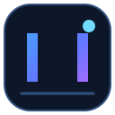

<!-- AZUL NEX | Repository landing page -->
<div align="center">



# AZUL NEX

### One PC. Infinite Devices.

**A clean, modern Windows control center for Android virtual devices.**

[](#requirements)
[](#)
[](LICENSE)
[](https://github.com/Azuliciado/AZUL-NEX/actions/workflows/windows-build.yml)

[Explore the project](#-what-is-azul-nex) · [Get started](#-getting-started) · [Roadmap](ROADMAP.md) · [Español](docs/ES.md)

</div>

---

> [!IMPORTANT]
> **Early development — alpha.** AZUL NEX is an interface and management layer for the official Android SDK Emulator and Android Debug Bridge (ADB). It is not an Android operating system, OEM firmware package, physical-device simulator, or device-identity spoofing tool. Features listed as planned are not available yet.

## ✦ What is AZUL NEX?

AZUL NEX brings common Android Virtual Device (AVD) tasks into one Windows desktop workspace. Instead of jumping between terminal commands, it gives you a focused place to discover emulators, request launches, inspect connected instances, and send basic controls.

Built by **Azuliciado**, with a dark interface, electric-blue accents, and a performance-conscious direction.

## ◈ What works today

| Area | Current capability | Status |
|---|---|---|
| SDK detection | Finds common Android SDK locations and environment variables | Implemented |
| AVD library | Lists AVDs already configured in Android Emulator | Implemented |
| Emulator launch | Requests launch of a selected AVD | Implemented |
| Running devices | Lists ADB-connected emulator instances | Implemented |
| Device controls | Sends Back, Home, and Recent key events | Implemented |
| APK install | Installs an APK on a selected running emulator | Implemented |
| Display presets | Shows a small set of example screen-size presets | Basic |
| Device creation | Create and configure AVDs inside AZUL NEX | Planned |
| Input mapping | Custom keyboard, mouse, and multi-touch mapping | Planned |
| Multi-instance tools | Clone, import, export, and organize device profiles | Planned |

The display presets are reference values only. They do not install Samsung, Google, Xiaomi, or other manufacturers' firmware and do not turn an AVD into a genuine device.

## ▣ Project direction

- **One workspace:** a clear home for Android virtual-device management.
- **Useful controls:** practical actions without needing to memorize every ADB command.
- **Hardware-aware:** sensible defaults and honest performance guidance for different PCs.
- **Bilingual:** English and Spanish project documentation.
- **Transparent:** clear separation between shipped functionality and roadmap ideas.

## ⌘ Getting started

### Requirements

- Windows 10 or Windows 11, 64-bit.
- .NET 8 SDK to build from source (or the .NET 8 Desktop Runtime for framework-dependent builds).
- Android SDK Platform-Tools (ADB).
- Android Emulator.
- At least one configured Android Virtual Device (AVD).
- Hardware virtualization configured as required by your Android Emulator installation.

### 1. Install Android tools

Install Android Studio or the Android SDK command-line tools. In SDK Manager, install **Android Emulator** and **Android SDK Platform-Tools**, then create an AVD in Device Manager.

### 2. Get the source

```bash
git clone https://github.com/Azuliciado/AZUL-NEX.git
cd AZUL-NEX
```

### 3. Run AZUL NEX

```bash
dotnet run --project src/AzulNex/AzulNex.csproj
```

If the SDK is not detected automatically, set `ANDROID_SDK_ROOT` to your Android SDK directory and restart the app.

### 4. Publish a standalone Windows build

```bash
dotnet publish src/AzulNex/AzulNex.csproj -c Release -r win-x64 --self-contained true -p:PublishSingleFile=true
```

The GitHub Actions workflow also builds the Windows app and packages an installer. Check the [Actions page](https://github.com/Azuliciado/AZUL-NEX/actions) for the latest result. A public installer should only be considered available after a successful workflow and a published release.

## ⚙ Performance notes

Android emulation can be demanding. The number of instances you can run smoothly depends on CPU virtualization support, memory, graphics drivers, emulator image, and resolution. Older or integrated-graphics systems may need a low-resolution AVD and a single running instance.

AZUL NEX does not promise a specific FPS, boot time, or number of simultaneous devices.

## 🧭 Roadmap

See the full [AZUL NEX roadmap](ROADMAP.md). The next priorities are:

1. Verify and stabilize the Windows build and installer.
2. Improve device lifecycle management and AVD configuration.
3. Add live device-screen viewing and configurable input mapping.
4. Add reliable multi-instance workflows and performance diagnostics.
5. Expand the device preset library with clearly sourced configuration data.

## 🧱 Technology

- C# and .NET 8
- Windows Presentation Foundation (WPF)
- Android Emulator
- Android Debug Bridge (ADB)
- GitHub Actions for Windows CI

## 🤝 Contributing

Ideas, bug reports, and thoughtful pull requests are welcome. Please read [CONTRIBUTING.md](CONTRIBUTING.md) and use the repository's issue templates.

- [Report a bug](https://github.com/Azuliciado/AZUL-NEX/issues/new?template=bug_report.yml)
- [Request a feature](https://github.com/Azuliciado/AZUL-NEX/issues/new?template=feature_request.yml)

## 🔐 Security

Please review [SECURITY.md](SECURITY.md) before reporting a vulnerability. Do not run APKs or tools from sources you do not trust.

## 📄 License

AZUL NEX's original repository code is distributed under the [MIT License](LICENSE). Android SDK components and other third-party software remain subject to their respective licenses.

---

<div align="center">

**AZUL NEX** · Crafted by **Azuliciado**

<sub>Built with curiosity. Designed for control.</sub>

</div>
